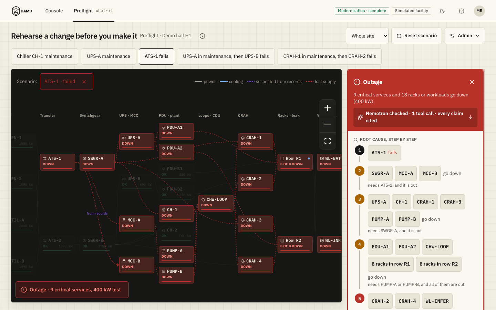
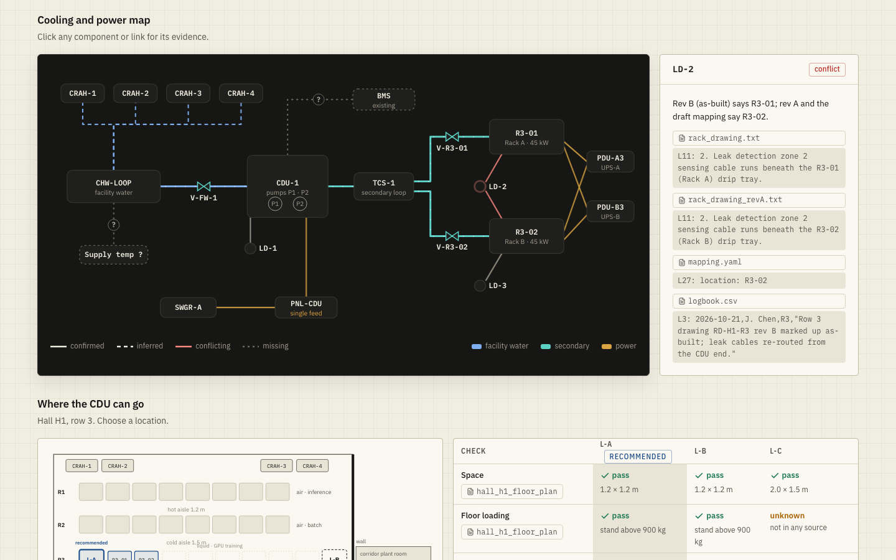
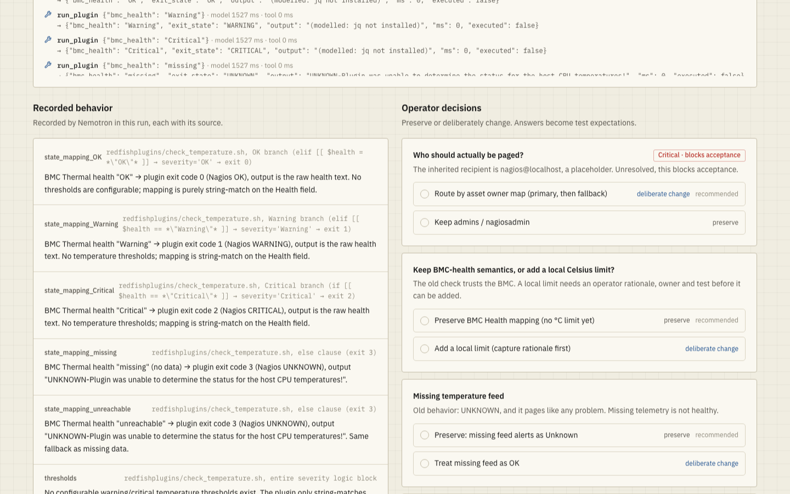
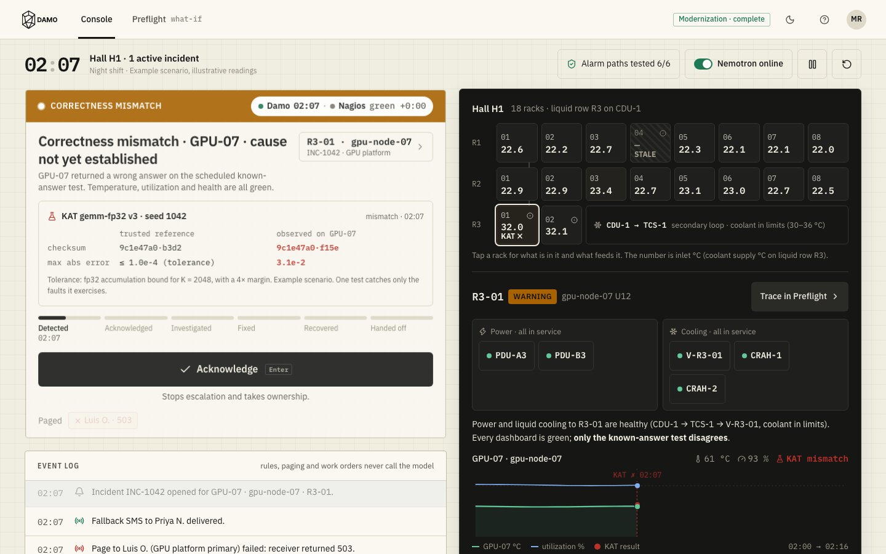
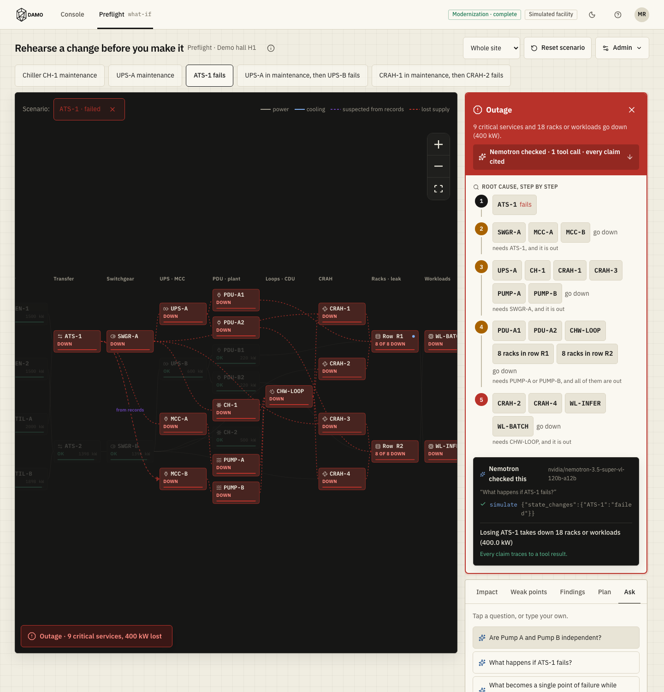
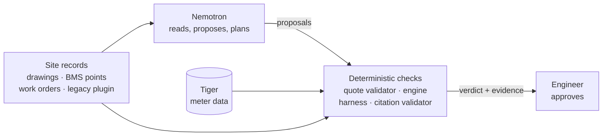

# DAMO

**Two pumps, two power paths, one transfer switch.** The one-line diagram says Pump A and Pump B are independent. A 2023 work order and a 2024 IR scan say both panels run through ATS-1. DAMO reads both, shows you the conflict with exact quotes, and simulates what happens when ATS-1 fails: 18 racks, 400 kW.

<p align="center">
  
</p>

DAMO helps engineers add liquid-cooled GPU racks to a data center that is already running. It reconciles drawings, BMS point lists and maintenance logs into one dependency graph, tests every integration change before handover, and carries that record into night-shift operations. Nemotron does the reading and planning. A deterministic engine and real test harnesses decide whether it was right.

HackUTD 2026 · NMC² · NVIDIA Nemotron · 8090 · MLH Best Use of Tiger Data

## What it does

<table>
<tr>
<td width="50%" valign="top">
<br>
<b>Retrofit setup</b> · <code>/#/setup</code><br>
Six steps from scattered records to a signed handover. The sample leak sensor is mapped to the wrong rack; the witnessed wet test catches it, and the fix is a one-line, sourced config diff.
</td>
<td width="50%" valign="top">
<br>
<b>Modernize</b> · <code>/#/modernize/import</code><br>
Takes the real <a href="https://github.com/nsfcac/Nagios-Redfish-API-Integration">Texas Tech HPCC Nagios–Redfish check</a> to Prometheus rules. A Nemotron agent reads the plugin with tool calls, records each behaviour with its source line, and asks the operator what code can't answer.
</td>
</tr>
<tr>
<td width="50%" valign="top">
<br>
<b>Console</b> · <code>/#/</code><br>
GPU-07 passes every health check and still returns the wrong checksum. The console ties the mismatch to the rack, its feeds and recent work, and walks the operator from acknowledge to handoff. Alerts never wait on the model.
</td>
<td width="50%" valign="top">
<br>
<b>Preflight</b> · <code>/#/preflight</code><br>
A what-if simulator for equipment work: cut sets, redundancy checks, ranked maintenance windows. Ask a question and the agent answers through <code>simulate</code> calls, citing every number.
</td>
</tr>
</table>

All 53 screens, step by step: [docs/screenshots](docs/screenshots/README.md).

## Architecture



Nemotron proposes; a check it can't influence accepts or rejects. Four of them:

- **Discovery** rejects any claimed dependency whose quote isn't in the source record word for word.
- **The Preflight agent** has eight tools (`simulate`, `find_cut_sets`, `evaluate_plan`, `search_plans`, `search_docs`, `get_node`, `get_neighbors`, `propose_dependency`). Its validator rejects an answer that names a node or number absent from the tool results it cites.
- **The harness** runs the original plugin as the reference. Held-out cases stay sealed from the repair agent, and a wrong-recipient mutant plus an alert-everything decoy prove the suite can fail.
- **The engine** computes support as a least fixpoint, so dependency cycles are safe. Cut sets come from MOCUS expansion up to order 3 and are cross-checked against brute force in the tests.

## Run it

```bash
make setup      # backend venv + frontend npm ci
make dev        # API on :8000, app on :5173
```

Open http://localhost:5173/#/about. No key needed: with `GAUNTLET_MODE=cached` the app replays recorded model responses, and the Preflight agent falls back to a scripted planner that labels itself.

For live model calls, copy `backend/.env.example` to `backend/.env` and set `NVIDIA_API_KEY`, `NEMOTRON_SUPER` and `NEMOTRON_NANO`. Model IDs on build.nvidia.com get retired; if a call returns HTTP 410, update the ID.

The Verify harness needs the real tools, otherwise it shows scripted results and says so:

```bash
sudo apt install monitoring-plugins-basic jq
make promtool
```

| Command | What it runs |
|---|---|
| `make test` | 168 backend tests (engine, discovery, retrofit, API, agent eval). About 11 minutes. |
| `make eval` | 24-question agent eval against the scripted planner; `EVAL_MODE=live` for Nemotron |
| `make rehearse` | Clicks through the Preflight demo in a browser and checks every number |
| `make meters-check meters-seed` | Creates and seeds the Tiger meter tables (`METERS_DATABASE_URL`) |
| `make db-up test-db` | Meter SQL tests against a local TimescaleDB container, never Tiger |

## Stack

| Layer | |
|---|---|
| Frontend | React, Vite, Tailwind |
| Backend | FastAPI, pure-Python dependency engine (`backend/engine/`) |
| AI | NVIDIA Nemotron Super (agents, rules) and Nano (short text), OpenAI-compatible API, every live response cached |
| Telemetry | Tiger (TimescaleDB): meter hypertable, hourly continuous aggregate, local snapshot when unreachable |
| Verification | Pinned legacy plugin, `promtool`, `amtool` |

## Limits

- **Sample data.** The facility, records, load profiles and retrofit site are synthetic. The retrofit screens replay a recorded run of the backend (`python -m app.retrofit.export`) rather than calling it live.
- **Power and cooling are kW budgets on a graph.** No CFD, hydraulics, electrical load flow or protection coordination. Transients use default timings (generator 15 s, UPS 5–8 min, chiller restart 6 min).
- **Cut sets treat whole nodes as failing.** Above order 1, a set that matters only through load shifting far from the failure can be missed.
- **Meters can't separate dual-fed loads.** Reconciliation only checks suppliers whose consumers each have one feed.
- **Bounded evidence.** Passing the harness covers the stated scenarios. It doesn't prove equivalence, and it doesn't replace physical commissioning.
- **Discovery recall** is 0.867–0.983 on 10 seeded sets of noisy records at 1.0 precision; most misses are digit-swap typos that spell another real tag.

## Repo

```text
frontend/   console, retrofit setup, modernize M1–M5, preflight
backend/    engine/ (simulator, cut sets, planner) · app/ (API, agents, harness, retrofit)
legacy/     pinned TTU Redfish plugins and Nagios objects
docs/       demo scripts, design notes, screenshots
```

Legacy plugin © Texas Tech HPCC, BSD-3-Clause; notices preserved in `legacy/ttu`. Team agents coordinate through Issues, protocol in [CLAUDE.md](CLAUDE.md).
